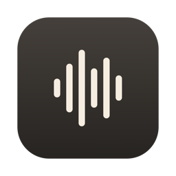
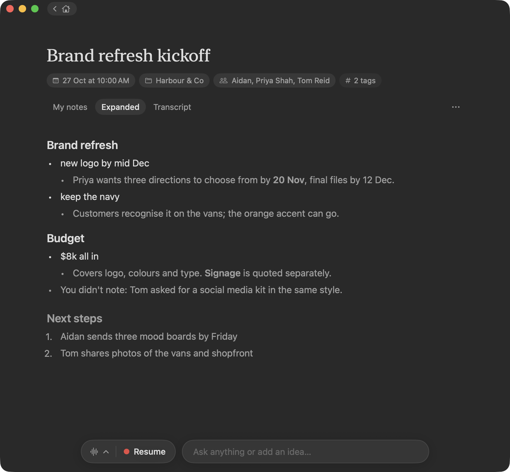
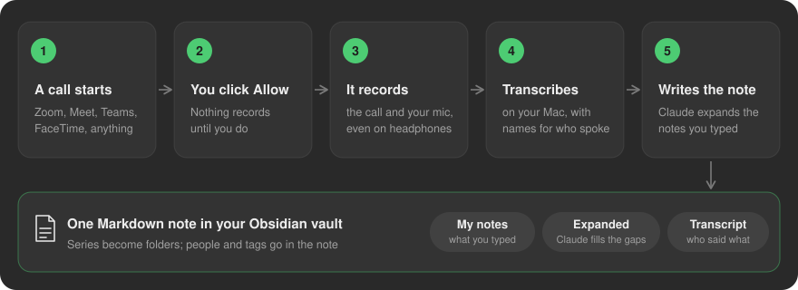
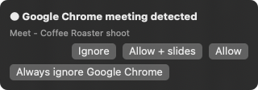
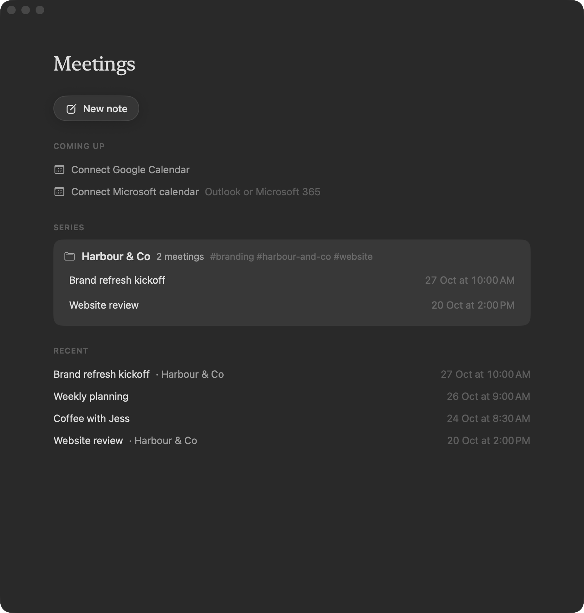
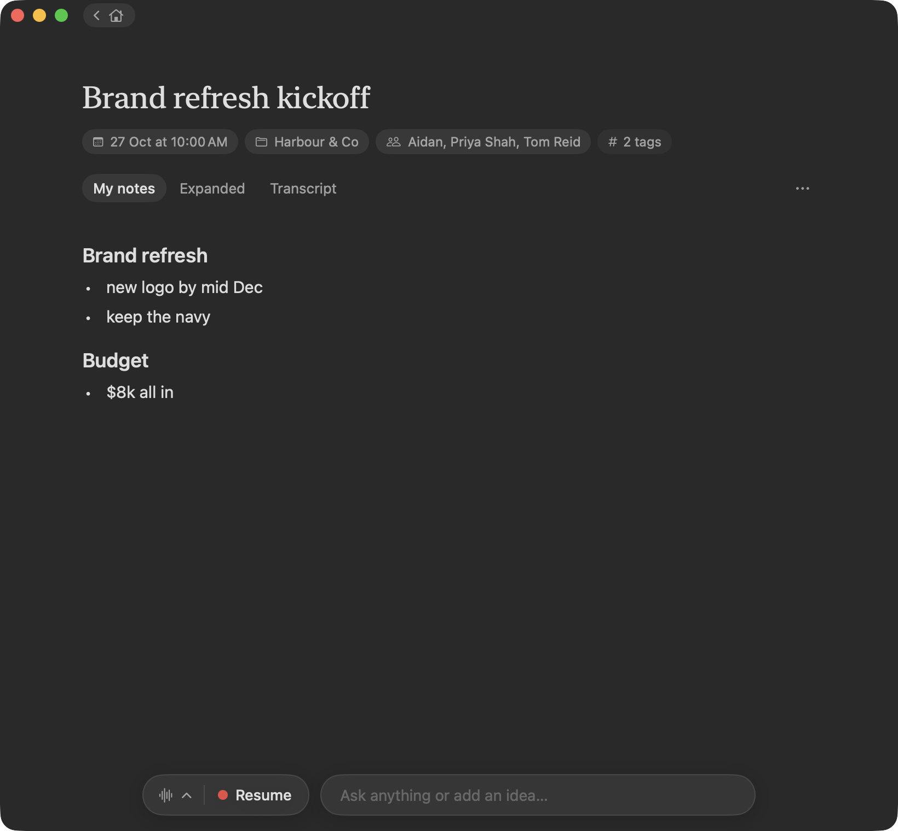
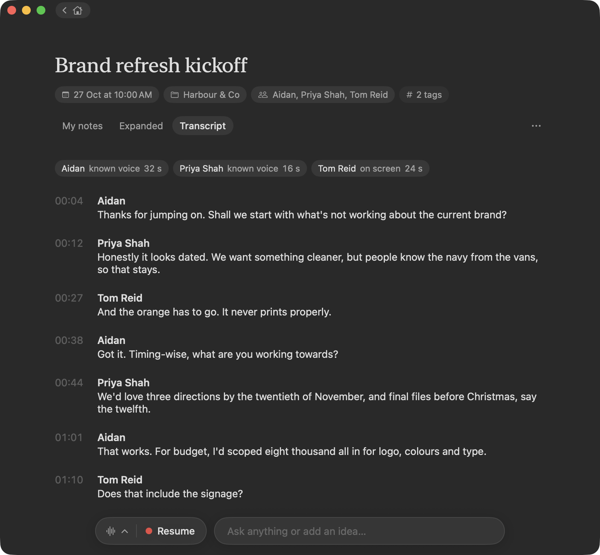
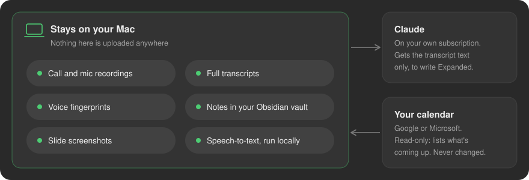

<p align="center">
  
</p>

<h1 align="center">Lyra</h1>

<p align="center">
  <b>Meeting notes that stay on your Mac.</b><br>
  Lyra records your calls and in-person meetings, then turns them into one note you own:<br>
  your notes, Claude's additions, and a full transcript with real names.
</p>

<p align="center">
  
</p>

---

## What it does

- **Notices when a call starts** in any app, including Zoom, Google Meet, Teams and FaceTime. It asks before
  recording anything.
- **Records the call itself**, straight from the meeting app, plus your microphone. It works with headphones in
  and the volume down, with no audio setup.
- **Transcribes on your Mac** and names who said what. It recognises voices it has learned, reads whose tile is
  lit on video calls, and picks up names from the conversation itself ("over to you, Sam").
- **Expands your notes.** You type a few words during the meeting. Afterwards Claude adds the detail underneath
  each one, plus anything important you missed and the next steps.
- **Files everything in Obsidian** as a plain Markdown note. Repeat meetings with the same client become a
  series with its own folder.
- **Shows what's coming up** from your Google or Microsoft calendar, with a one-click Join.
- **Saves slides** from the call when you switch it on, as a backup for decks that never get sent.
- **Picks up where you left off.** Pause and resume a recording, record more into a note after it has ended, or
  resume into the same note if Lyra was quit mid-meeting.
- **Keeps your own folders** in a sidebar, each with a colour. They are real Obsidian folders, so dragging a note
  into one files it there in your vault too.

## How it works

<p align="center">
  
</p>

When an app starts using the microphone, a small prompt drops from the menu bar:

<p align="center">
  
</p>

**Allow** records. **Allow + slides** also saves the slides that get shared. **Ignore** skips this call, and
**Always ignore** stops asking for that app. Lyra never records without one of those clicks. The one exception
is when you press **Join** on an upcoming meeting in Lyra itself.

## A tour

### Home

Upcoming meetings sit at the top. Below them are your series and your recent notes. **New note** starts a blank
note for an in-person meeting. It only records once you press Record. While something records, a live card takes
its place, with the meeting's title and running time.

If Lyra was quit during a recording, the next launch shows a **Resume** card for that meeting. Resume carries on
in the same note, and both halves become one transcript. **Not now** writes the note up as usual.

<p align="center">
  
</p>

### Your notes, then Claude's

Type what matters during the meeting. When it ends, the **Expanded** tab keeps every line you wrote and adds
Claude's detail in grey beneath it. You can edit either one. **My notes** is never touched by Lyra or Claude.

<table>
  <tr>
    <td width="50%"></td>
    <td width="50%"></td>
  </tr>
  <tr>
    <td align="center"><sub>What you typed</sub></td>
    <td align="center"><sub>After the meeting</sub></td>
  </tr>
</table>

The editor keeps things simple: bullets that nest with Tab and Shift-Tab, dividers (type `---` and press
Return), and pictures. Paste or drop an image and it is saved right beside the note and shown in Obsidian too.
Every line, pictures included, can be dragged up or down by its handle.

The bar at the bottom lets you ask Claude about the meeting, add an idea, or pick up recording again.

### The full transcript, with names

Every word, with a timestamp and a name. Each name is marked with how Lyra knows it: a **known voice**, a name
read **on screen**, a name heard **from the talk**, or one you set. Click a name heard from the talk to see the
lines it came from and confirm it. **Suggest names** asks Claude to name any voices still marked "Speaker N".
When you rename "Speaker 2" once, Lyra learns that voice for every meeting after.

If Lyra couldn't see the call window during a video call, which it needs for names on screen and slides, the note
says so and why.

<p align="center">
  
</p>

## Private by design

<p align="center">
  
</p>

- Speech becomes text on your Mac, using [FluidAudio](https://github.com/FluidInference/FluidAudio)'s Parakeet
  and speaker models. Audio and voice fingerprints never leave the Mac.
- Claude is reached through the `claude` command-line tool on your own Claude subscription. No API key is
  used, and only the text it needs is sent.
- Calendar sign-ins are kept in the macOS Keychain, and the calendar is only ever read.
- Nothing is ever permanently deleted. Removing a note moves it and its recordings to the Mac's Trash.
- Lyra never silently overwrites an edit, whether you made it in Lyra or in Obsidian.

## Where things live

| What | Where |
| --- | --- |
| Notes | `~/Documents/Obsidian Vault/Aidan Business/Meetings/` (a series is a subfolder with its own page) |
| Recordings | `~/Documents/Lyra Recordings/YYYY-MM-DD HHmm — title/` (audio, transcript, speakers, slides) |
| People and voices | `~/Library/Application Support/Lyra/` (readable only by you) |

Each note has three sections, **My notes**, **Expanded** and **Transcript**, so it reads well in Obsidian too.

## Building it

You need a Mac with Apple Silicon running macOS 15 or later, Xcode with Swift 6, and the
[Claude Code](https://claude.com/claude-code) CLI signed in to a Claude subscription.

```bash
swift test                                   # unit tests
LYRA_INTEGRATION=1 swift test                # plus real audio, speech and Claude checks
scripts/build-app.sh                         # builds build/Lyra.app
scripts/install-app.sh                       # quits Lyra, installs to /Applications, reopens it
```

On first run macOS asks for the microphone, the meeting app's audio and, for names on screen and slides, screen
recording. Screen recording is set in System Settings › Privacy & Security › Screen & System Audio Recording.
Then use **Lyra › Teach Lyra my voice…** so your own lines come out under your name. Use **Lyra › Settings…** to
open Lyra when you log in.

Lyra lives in the menu bar. Click its icon to show or hide the window, or right-click it for the menu. Closing the
window keeps any recording going.

### Project layout

| Target | What's in it |
| --- | --- |
| `LyraCore` | All the logic that can be tested on its own: notes, transcripts, people, series, calendar, Claude prompts |
| `LyraAudio` | Core Audio taps for the meeting app, the microphone, and watching the call window |
| `LyraSpeech` | Speech-to-text and speaker separation, after the meeting and live |
| `Lyra` | The SwiftUI and AppKit app: menu bar, window, editor |

The app's central `AppModel` is split by area (`AppModel+Detection`, `+Recording`, `+Processing`), so features
built in parallel rarely edit the same file.

Design notes live in [`docs/superpowers/specs/`](docs/superpowers/specs/). Measured findings and handoffs live in
[`docs/notes/`](docs/notes/).

---

<p align="center"><sub>Made by Aidan Mascaro in Perth, Western Australia. The meetings shown above are made up.</sub></p>
